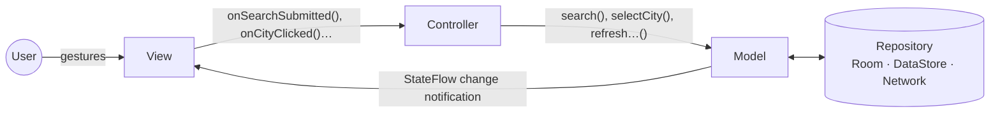

# WeatherTracking — an MVC example in Jetpack Compose

Search for a city, see its current weather, and keep it as your selected city across launches.

This project shows **Model–View–Controller (MVC)** done properly in a modern Android app
(Jetpack Compose, Hilt, Room, DataStore, Retrofit). Its sister project,
[News-App](https://github.com/ZENSH1/News-App), implements the same ideas with **MVI**, so you
can compare the two side by side.

---

## 1. What is MVC?

MVC splits an app into three roles:

| Role | Responsibility | In this app |
|---|---|---|
| **Model** | The data and the business rules. Notifies observers when it changes. Knows nothing about the UI. | [`WeatherModel`](app/src/main/java/com/example/weathertracking/weather/model/WeatherModel.kt) + the `data` layer behind it |
| **View** | Draws the Model. Captures user input and passes it to the Controller. No logic. | [`WeatherScreen` / `WeatherView`](app/src/main/java/com/example/weathertracking/weather/view/WeatherScreen.kt) (Compose) |
| **Controller** | Interprets user input and tells the Model what to do. Holds no screen state. | [`WeatherController`](app/src/main/java/com/example/weathertracking/weather/controller/WeatherController.kt) |

The arrows are what make it MVC:



1. **View → Controller.** The View never decides anything. It hands every gesture to the
   Controller as it happened ("the user submitted *‘ new  york ’*").
2. **Controller → Model.** The Controller interprets the input. It trims the text, ignores a blank
   query, skips a search that is already on screen. Then it calls the right Model operation.
3. **Model → View.** The Model updates its own state. The View is *observing* the Model
   (`StateFlow` + `collectAsStateWithLifecycle()`), so it redraws by itself.
   **The Controller never pushes data to the View.**

That last point is the key difference from MVP (the Presenter drives the View) and MVVM (the
ViewModel builds a view-specific state). In MVC the View reads the Model directly.

### Walk-through: searching for "London"

```text
SearchField (View)        user taps the search key
  └─▶ controller.onSearchSubmitted("  London ")
        ├─ trims to "London", not blank, not already on screen
        └─▶ model.search("London")
              ├─ search = Searching("London")         ──▶ View shows a spinner
              ├─ repository.search("London")           (network, 8 results max, in parallel)
              └─ search = Results("London", [...])     ──▶ View shows the list
CityResultCard (View)     user taps "London, United Kingdom"
  └─▶ controller.onCityClicked(city)
        └─▶ model.selectCity(city)
              ├─ search = Idle  (business rule: picking a city ends the search)
              └─ repository.select(city)               (Room + DataStore)
                   └─ selectedCity flow emits          ──▶ View shows the weather card
```

## 2. Why MVC here, and when to use it

**Why it fits this app.** There is one screen, a small amount of state, and real business rules:
only the latest search counts, one refresh at a time, auto-refresh after 30 minutes, and picking a
city ends the search. MVC puts those rules in one plain Kotlin class (the Model) that is trivial to
unit test. The View stays a dumb renderer.

**Benefits**
- **Separation of concerns.** Rules live in the Model, input handling in the Controller, drawing in the View.
- **Testability.** `WeatherModel` and `WeatherController` are plain Kotlin with no Android imports.
  They are tested on the JVM with a fake repository (`WeatherModelTest`, `WeatherControllerTest`).
- **One source of truth.** Several Views could observe the same Model (e.g. a widget) and stay in sync.
- **Familiar and simple.** It is the oldest UI pattern around, and there is very little boilerplate.

**Drawbacks and when to pick something else**
- State is spread over several observable properties (`selectedCity`, `search`). As a screen
  grows, keeping them consistent gets harder. **MVI** (see News-App) fixes that with one immutable
  state and a pure reducer.
- One-off events (navigate, show a snackbar) have no natural home in MVC. MVI models them as *effects*.
- "Android MVC" is often misread as "put everything in the Activity" (the *Massive Activity*
  anti-pattern). Here the Activity is only the composition root that wires M, V and C together.

**Rule of thumb:** MVC is a good default for small screens with a rich domain model. Move to
MVVM/MVI when a screen accumulates lots of UI-only state, events and async flows.

### How the Android lifecycle is handled without a ViewModel

- `WeatherModel` is a Hilt **`@Singleton`**. It runs its coroutines in an app-wide
  `@ApplicationScope` (`core/di/AppModule.kt`). Rotation recreates the View and the Controller, but
  the Model, and any request in flight, keeps going.
- `WeatherController` is **stateless**, so a fresh instance per Activity is correct.
- The View observes with `collectAsStateWithLifecycle()`, so collection stops in the background.
  `selectedCity` uses `SharingStarted.WhileSubscribed(5_000)`, which stops the database
  subscription once nobody is watching.
- Text being typed is View state (`rememberSaveable`). It survives rotation and process death, and
  the Controller only sees it when the user submits.

## 3. Project structure

```text
app/src/
├── main/java/com/example/weathertracking/
│   ├── MainActivity.kt            composition root: wires Model + Controller into the View
│   ├── WeatherTrackerApp.kt       @HiltAndroidApp
│   ├── weather/
│   │   ├── model/                 M: WeatherModel, SelectedCityState, SearchState
│   │   ├── controller/            C: WeatherController
│   │   └── view/                  V: WeatherScreen (binding), WeatherView (stateless) + components
│   ├── data/                      what the Model is built on
│   │   ├── model/                 CityWeather, FailureReason / WeatherDataException
│   │   ├── repository/            WeatherRepository (+ DefaultWeatherRepository)
│   │   ├── local/                 Room (CityWeatherEntity, CityWeatherDao) + DataStore (SelectedCityStore)
│   │   └── remote/                WeatherRemoteDataSource interface
│   ├── core/                      Hilt modules, TimeSource
│   └── ui/theme/                  Material 3 theme (dynamic color on Android 12+)
├── mock/                          offline backend: FakeWeatherRemoteDataSource + its Hilt binding
├── prod/                          weatherapi.com backend: Retrofit + kotlinx.serialization
├── test/                          JVM tests: Model, Controller, Repository, Robolectric View tests
├── testProd/                      Retrofit data source vs. MockWebServer
└── androidTest/                   Room DAO against real SQLite
```

## 4. Backends: `mock` and `prod` flavors

The Model doesn't know or care where the data comes from: only the Hilt binding for
`WeatherRemoteDataSource` changes between flavors.

| Build variant | Data | Needs |
|---|---|---|
| `mockDebug` (default) | 20 canned cities with slowly drifting readings and simulated latency. Search **`offline`** to see the error state. | Nothing |
| `prodDebug` | Live data from [weatherapi.com](https://www.weatherapi.com/) | A free API key |

To use the real API, add your key to `local.properties` (git-ignored):

```properties
WEATHER_API_KEY=your_key_here
```

Then select **prodDebug** in Android Studio's *Build Variants* panel. The key is injected through
`BuildConfig`. It is no longer committed in source code.

## 5. Build, run, test

Requirements: an Android Studio version that supports AGP 9.4, JDK 17+, Android SDK 37.

```bash
./gradlew :app:installMockDebug            # run with the offline backend
./gradlew :app:testMockDebugUnitTest       # Model, Controller, Repository, View (Robolectric)
./gradlew :app:testProdDebugUnitTest       # same + Retrofit data source vs MockWebServer
./gradlew :app:connectedMockDebugAndroidTest  # Room DAO on a device/emulator
```

## 6. Android best practices applied

Following the official [Android skills](https://github.com/android/skills) and Google's
architecture guidance:

- **Build** (`agp-9-upgrade`): AGP 9.4 with built-in Kotlin (no `kotlin-android` plugin), Gradle
  9.8, a version catalog, KSP instead of kapt, BuildConfig fields through the variant API,
  configuration cache, and R8 with resource shrinking for release.
- **Edge-to-edge** (`edge-to-edge`): `enableEdgeToEdge()`, `adjustResize`, and a `Scaffold`
  using `WindowInsets.safeDrawing` so the IME never covers content. List insets go into
  `contentPadding`, so the list scrolls behind the system bars.
- **Compose** (`jetpack-compose-performance`): stateless composables with previews, stable
  `key` + `contentType` in lazy lists, lifecycle-aware collection, no side effects during
  composition, and `LifecycleStartEffect` for "screen started" input.
- **Testing** (`testing-setup`): fakes over mocks, JVM tests for business logic,
  Robolectric-backed Compose UI tests, an instrumented Room test with an in-memory database, and
  MockWebServer for the network layer.
- **Data**: offline-first. The selected city is read from Room/DataStore, the network only
  writes, all suspend functions are main-safe, and failures are mapped to a small `FailureReason`
  type instead of leaking Retrofit or IO exceptions.

> **Security note:** earlier versions of this repo had a weatherapi.com key hard-coded in
> `Constants.kt` and `strings.xml`. It is still in the git history, so revoke it and use a new key
> via `local.properties`.
